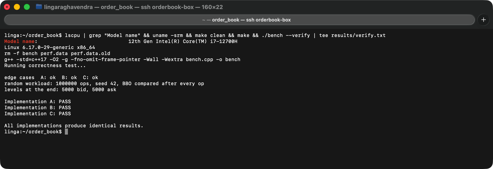
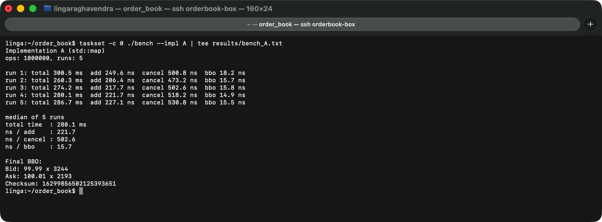
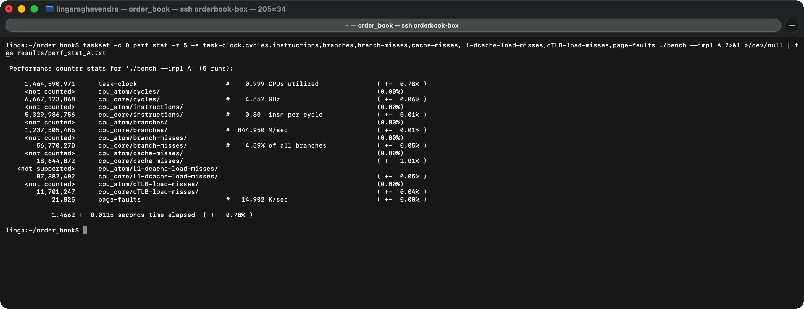
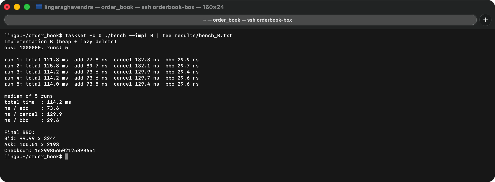
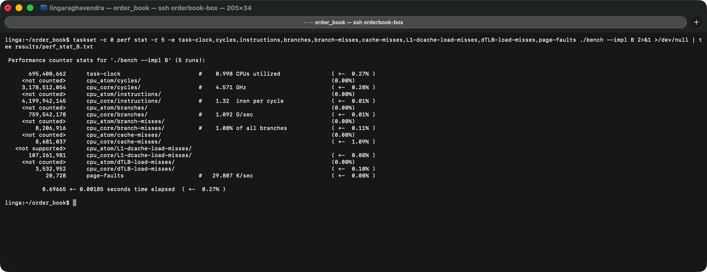
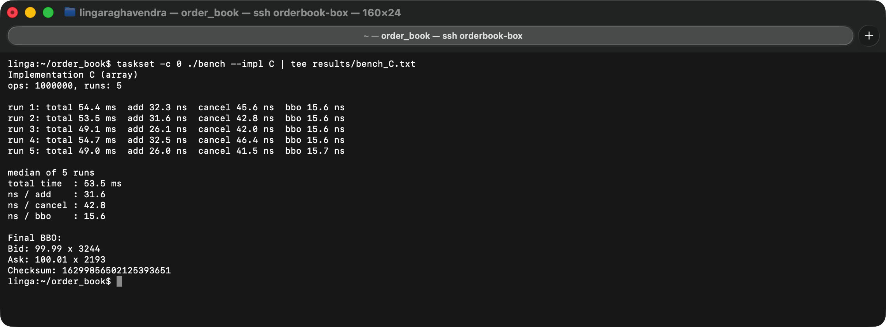

# Capstone: Low-Latency Order Book

name: Linga Seetha Rama Raghavendra

email: seeta.24bcs10250@sst.scaler.com

roll_no: 24BCS10250

I built a resting order book for one instrument three times, with three different data structures (map, heap and array). Then I checked that all three give the same answers, benchmarked them on the same workload and profiled them with Linux `perf`. The analysis is in [REPORT.md](REPORT.md).

## What I did

1. Wrote the three books behind the same five functions: `add_order`, `cancel_order`, `get_bbo`, `get_bids`, `get_asks`.
2. Wrote one program, `bench`, that runs the correctness test (`--verify`) or the benchmark for one book (`--impl A|B|C`).
3. Ran the correctness test first. All three give the same results on a 1M op random workload.
4. Ran the benchmark, `perf stat` and `perf record` for each book on a Linux laptop and saved the raw output in `results/`.
5. Filled the results table and wrote the report from those numbers.

## Files

```
common.hpp      Price type, Side, Level, BBO, Order and small helpers
map_book.hpp    Implementation A (std::map)
heap_book.hpp   Implementation B (priority_queue with lazy delete)
array_book.hpp  Implementation C (fixed arrays indexed by price)
bench.cpp       workload, --verify and --impl
Makefile
REPORT.md       results table and performance analysis
results/        raw output of verify, bench, perf stat, perf report
screenshots/
```

## Build and run

```
make
./bench --verify
./bench --impl A
./bench --impl B
./bench --impl C
```

`make` runs `g++ -std=c++17 -O2 -g -fno-omit-frame-pointer -Wall -Wextra bench.cpp -o bench`. The books are header only so there is only one file to compile. `-g` and `-fno-omit-frame-pointer` are only there so `perf report` can show function names and call stacks.

`--runs N` and `--ops N` can change the defaults (5 runs, 1,000,000 ops).

## Interface change

Prices are integers, not `double`. A price is stored as a number of ticks of 0.01, so 100.01 is `10001` and 50.00 is `5000`.

```cpp
using Price = uint64_t;
void add_order(uint64_t id, Side side, Price price, long qty);
```

`Level` and `BBO` also hold `Price`. A `double` like 100.01 can't be stored exactly, and comparing or using doubles as map keys is risky, so I kept everything as whole numbers and only turn it back into `100.01` when printing.

`add_order` ignores an order with a price outside its band, qty <= 0, or an id that is already live. Everything else matches the given API.

## The three designs

**A: map.** Price levels are `std::map<Price, long>` per side (bids sorted high to low with `std::greater`, asks low to high). Orders are in a `std::map<id, Order>`. Best price is `begin()` of each map. Cancel looks the id up in the orders map, takes the qty off its level and erases the level if it hits 0.

**B: heap.** Level quantities are in an `unordered_map<Price, LevelInfo>` per side, and the prices are in a `priority_queue` (max heap for bids, min heap for asks). Orders are in an `unordered_map<id, Order>`. Cancel only lowers the qty and leaves the price in the heap (lazy delete). `get_bbo` pops dead prices off the top until it finds a level with qty > 0. Each level has an `in_heap` flag so a price is never pushed twice. Depth copies the heap and pops until it has enough live levels, because a heap can only give you the top.

**C: array.** One `long` slot per price, in two vectors of 5000 that are sized once in the constructor and never grow: `bid_qty` for 50.00 to 99.99 and `ask_qty` for 100.01 to 150.00. The index of the best bid and best ask is stored and updated on add. If a cancel empties the best level, it walks down (bids) or up (asks) to the next non-empty slot. Orders are in a `vector<Order>` where the index is the order id, so cancel is a direct lookup. This assumes ids are small increasing numbers, which they are in this workload.

| | A map | B heap | C array |
|---|---|---|---|
| orders stored in | `std::map` (tree) | `unordered_map` (hash) | `vector` indexed by id |
| levels stored in | `std::map` | `unordered_map` + `priority_queue` | one slot per price (size 5000 per side) |
| best price | `begin()` | heap top (after popping dead prices) | stored index |
| find order on cancel | tree search | hash lookup | `orders[id]` |

Complexity, with N live orders, L levels on a side (at most 5000) and d the depth asked for:

| Operation | A map | B heap | C array |
|---|---|---|---|
| `add_order` | O(log N + log L) | O(1) avg, + O(log L) for a new price | O(1) |
| `cancel_order` | O(log N + log L) | O(1) avg | O(1), O(5000) worst if the best level empties |
| `get_bbo` | O(1) | O(1) amortized, each dead price is popped once for O(log L) | O(1) |
| `get_bids` / `get_asks` | O(d) | O(L) to copy the heap + O((d + dead prices) log L) to pop | O(d + empty slots skipped) |

## Correctness test

`./bench --verify` first runs small hand-written cases on each book:
- empty book
- cancelling an unknown id
- cancelling the same id twice
- two orders at one price adding up
- asking for 10 levels when only 2 exist
- the best price moving when a level empties
- a price level coming back after being emptied

Then it runs the same 1M op random workload (seed 42) through A, B and C together. After every op it compares the BBO and every cancel result, every 100 ops it compares the top 10 bids and asks, and at the end it compares every level on both sides. A is the reference, so A's PASS comes from the hand-written cases and B and C must also match A.

I also broke each book on purpose once to make sure `--verify` catches it, and it printed FAIL every time.



## Benchmark

The workload is built once before any timing, with `std::mt19937 rng(42)`:
- 1,000,000 ops: about 70% add, 20% cancel, 10% BBO
- side 50/50, qty 1 to 100, price a random tick in that side's band
- every cancel picks a random live order
- every 100 ops it also calls `get_bids(10)` and `get_asks(10)`

I use `rng() % n` instead of `uniform_int_distribution` so the same seed gives the same ops on mac and linux.

Each add, cancel and BBO call is timed on its own with `std::chrono::steady_clock`. Each book runs 5 times and the median is printed. The final BBO and a checksum of every cancel result, BBO and depth result are printed at the end, so the compiler can't throw the work away. All three books print the same checksum `16299856502125393651`.

## perf

My Mac doesn't have `perf`, so I ran this part on a friend's Ubuntu laptop. I pinned the program to one core with `taskset -c 0`, so the `cpu_atom` lines in perf show `<not counted>` and the numbers are on the `cpu_core` lines.

```
taskset -c 0 perf stat -r 5 -e task-clock,cycles,instructions,branches,branch-misses,cache-misses,L1-dcache-load-misses,dTLB-load-misses,page-faults ./bench --impl A
taskset -c 0 perf record -g ./bench --impl A
perf report
```

The `perf report` output for each book is in `results/`.

## Run output

### A: map





### B: heap





### C: array




## Results

| Metric | A map | B heap | C array |
|---|---|---|---|
| Total time (ms) | 280.1 | 114.2 | 53.5 |
| ns / add | 221.7 | 73.6 | 31.6 |
| ns / cancel | 502.6 | 129.9 | 42.8 |
| ns / BBO | 15.7 | 29.6 | 15.6 |
| IPC | 0.80 | 1.32 | 1.92 |
| Branch misses (%) | 4.59% | 1.08% | 1.40% |
| L1-dcache-load-misses | 87,882,402 | 107,261,981 | 6,253,914 |
| Cache misses | 18,644,872 | 8,681,037 | 2,351,080 |
| dTLB-load-misses | 11,701,247 | 3,532,952 | 300,646 |
| Page faults | 21,825 | 20,728 | 24,219 |

The time rows are the median of 5 runs from `./bench`. The counter rows are from `perf stat -r 5`. Why the numbers look like this is explained in [REPORT.md](REPORT.md).
